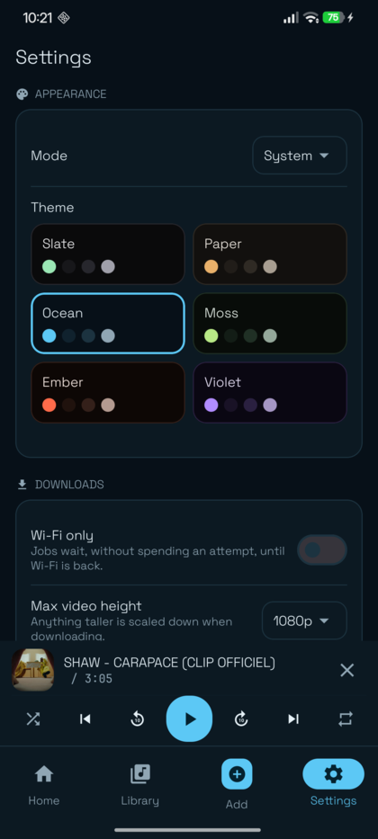

<p align="center">
  
</p>

<h1 align="center">MediaManager for Android</h1>

<p align="center">
  A private media library that lives on your phone.<br/>
  Paste a link, keep the audio or the video, play it back — no account, no server, no sync.
</p>

<p align="center">
  <a href="#what-it-does">What it does</a> ·
  <a href="#build">Build</a> ·
  <a href="#how-it-works">How it works</a> ·
  <a href="#design">Design</a>
</p>

<p align="center">
  
  
  
</p>

## What it does

**A link becomes a library.** Paste a YouTube or yt-dlp URL, pick audio or video, and
the file lands in an app-private library with cover art. Pictures, PDFs and EPUBs
upload the same way.

**Downloads built for a phone line.** Each file is split across several ranged HTTP
connections, two jobs run at once by default, and the queue survives the process
being killed. Progress never overshoots, cancelling stops only the job you picked,
and a URL already in the library is refused instead of fetched twice.

**Video that actually plays.** Most YouTube videos have no muxed stream at all, so the
app downloads the picture and the sound on separate connections and remuxes them to
MP4 with `MediaMuxer` — WebM, then ffmpeg, if the platform muxer balks.

**A player worth using.** One ExoPlayer for the whole app, a queue you can reorder and
prune, resume points saved to disk, a prompt before restarting long media, and an
immersive video surface sized to the real video.

**It fits the screen you have.** Portrait phones get the bottom bar and the square
player; a landscape phone gets a navigation rail, a one-row mini player and a
side-by-side player, because 891×411 dp has width to spare but almost no height. A
tablet gets the rail *and* the two-pane player. Breakpoints are in
`ui/adaptive/WindowInfo.kt` and unit-tested.

**You can see where the space went.** Library total, phone usage from `StatFs`,
breakdown by kind, and every item ranked by size with the bytes a delete frees.

**Yours alone.** No network service, no login. Everything is in the app's private
storage; uninstalling is the only sync that exists.

## Build

Requirements: JDK 21, Android SDK (platform 36), and `adb` for a device.

```sh
make build      # debug APK  → androidApp/build/outputs/apk/debug/
make test       # unit + Robolectric tests
make check      # tests + lint
make fmt        # ktlint: format the Kotlin sources
make hooks      # install the pre-push hook (ktlint + Android lint)
make coverage   # unit-test coverage → androidApp/build/reports/coverage/
make install    # installs on the connected phone, refusing if space is short
make release    # signed APK, needs the keystore properties sourced
```

`make hooks` points git at `.githooks/`, where a pre-push hook runs `ktlintCheck` and
`lintDebug`; bypass it once with `git push --no-verify`. Formatting is ktlint 1.8
(`make fmt`), configured in `.editorconfig`.

132 tests live under `androidApp/src/test`, with Robolectric where a database or
context is needed. Android Lint is the linter (`make lint`).

The release build reads `MM_STORE_FILE`, `MM_STORE_PASSWORD`, `MM_KEY_ALIAS` and
`MM_KEY_PASSWORD` (or the same keys in `local.properties`). Without them it falls
back to the debug key.

## How it works

```
androidApp/        the Gradle module: Compose UI, Media3 playback, Room, downloads
androidApp/src/    sources, Room schemas under androidApp/schemas, resources
iosApp/            placeholder — a separate native app, see its README
docs/              brand assets, screenshots, architecture notes
```

- **Room is the only source of truth.** The library, playlists, queue and jobs are
  tables; nothing is cached in memory as the authority.
- **Jobs are rows, not tasks.** `DownloadService` claims a row with a lease, heartbeats
  every 15 s, and a reaper re-queues rows whose lease expired. A killed process costs
  nothing.
- **Finalize order matters:** write `.incoming/<job>`, rename into the library, insert
  the item, mark the job done. Keep it.
- **Storage is sharded:** `<kind>/<id[0:2]>/<id>.<ext>`, thumbnails in `thumbs/`.

Full rules and gotchas live in [`AGENTS.md`](AGENTS.md).

## Design

Six theme families in light and dark, a single accent, Space Grotesk for text and
JetBrains Mono for numbers, with the Arabic face bundled so titles render correctly
offline. The mark is a bold `M` whose counter is cut to a point — see
[`docs/brand/`](docs/brand/).

## Licence

GPL-3.0. The app bundles yt-dlp, FFmpeg (via `youtubedl-android`) and NewPipe
Extractor; their licences are listed in Settings → About.
