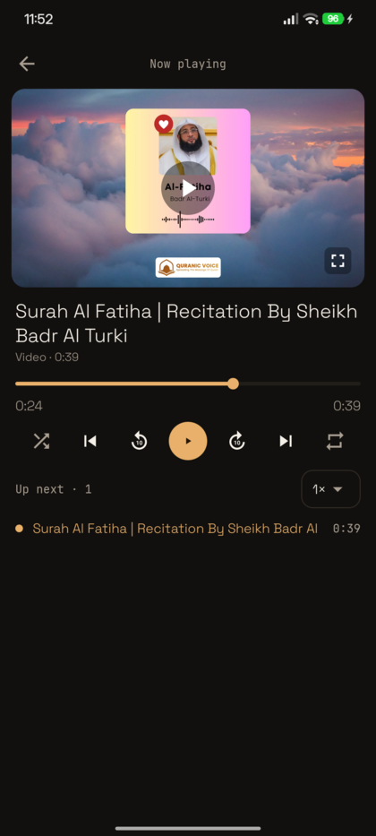
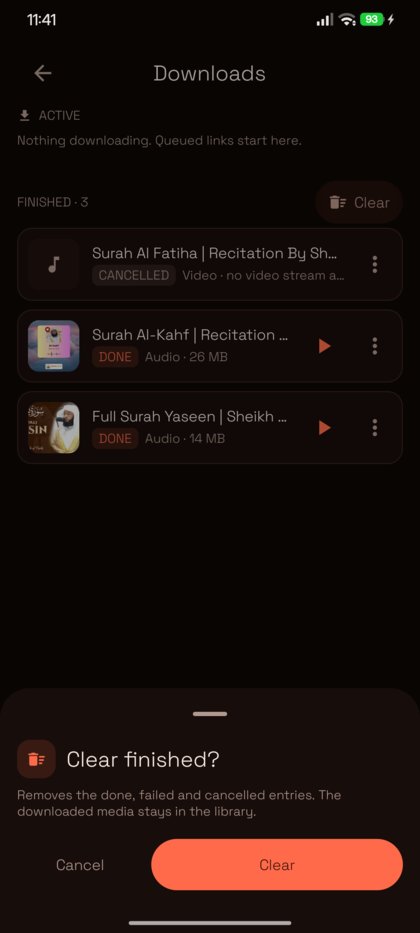

<p align="center">
  
</p>

<h1 align="center">MediaManager</h1>

<p align="center">
  A private library for everything you download and save.<br/>
  Rust + SQLite on a machine you own. Web, desktop, and a standalone Android app.
</p>

<p align="center">
  <a href="#design">Design</a> ·
  <a href="#the-android-app">Android</a> ·
  <a href="#quick-start">Quick start</a> ·
  <a href="#architecture">Architecture</a> ·
  <a href="#documentation">Docs</a>
</p>

<p align="center">
  
  
  
</p>

## What it does

**A link becomes a library.** Paste a YouTube or yt-dlp URL, pick audio or video,
and the file lands in a sharded folder tree with cover art. Uploads handle pictures,
PDFs and EPUBs.

**A player worth using.** One queue that survives navigation, resume points saved to
disk, shuffle, repeat, speed, a queue you can reorder, and video that seeks properly
because files stream with HTTP Range instead of being buffered.

**Organised, not piled up.** Ordered playlists mix audio and video. Pictures live in
galleries with a protected default. Both use the same picker, and any playlist can
borrow a cover from its own items.

**You can see where the space went.** Idle downloads can be evicted after a month,
metadata kept, and the player re-fetches on demand. Storage reports real per-item
sizes and the exact bytes a delete frees.

**Yours alone.** Email + password, rows and files scoped per owner, admin tooling, and
`404` — never `403` — for another person's data. The Android app has no account at
all, because it needs no server.

## Design

The UI is a small, deliberate system rather than a pile of Material defaults. One set
of tokens, six theme families, two modes.

| Token | Role |
|---|---|
| `canvas` | App background |
| `panel` / `panel-2` | Cards, sheets, tracks |
| `line` / `line-strong` | Hairline borders |
| `ink` / `muted` | Primary and secondary text |
| `accent` / `accent-ink` | Actions, and the colour that sits on them |
| `danger` | Destructive intent |

| Family | Canvas (dark) | Accent (dark) |
|---|---|---|
| **Slate** | `#0A0A0B` | `#9AE6B4` |
| **Paper** | `#12100E` | `#E8B06A` |
| **Ocean** | `#071018` | `#5CC8F5` |
| **Moss** | `#080C09` | `#B8E986` |
| **Ember** | `#0D0705` | `#FF6B4A` |
| **Violet** | `#0A0712` | `#B18CFF` |

Each family also ships a light palette. Mode (light / dark / system) and family are
account settings on the web and per-device settings on Android, applied before the
first frame so nothing flashes.

**Type.** Space Grotesk for everything, JetBrains Mono for numbers and durations, and
Noto Sans Arabic UI bundled as woff2 so Arabic titles render correctly instead of
falling back to whatever the WebView picks.

**Interaction rules that hold everywhere:**

- Popovers are portaled — menus inside cards and sidebars never get clipped.
- Confirmations are sheets with a headline, one line of context, and a full-width
  action; no tiny text buttons squeezed into a footer.
- Progress is a plain track-and-fill bar. Material's indicator leaves a stop dot
  floating beside the fill.
- The destructive action uses the theme accent, so a red theme does not turn every
  button into an alarm.

## The Android app

`apps/mobile` is a standalone Kotlin/Compose app. No account, no server, no sync: its
own Room database and its own library in app-private storage.

- **YouTube without yt-dlp.** NewPipe Extractor fetches anonymously, so no JS runtime
  and no PO token. Everything else goes through the bundled yt-dlp.
- **Video that actually plays.** Most YouTube videos have no muxed stream at all. The
  app downloads the picture and the sound on separate connections and remuxes them to
  MP4 with `MediaMuxer`, falling back to WebM and finally to the bundled FFmpeg.
- **Downloads tuned for a phone line.** Each file is split across four HTTP ranges;
  two jobs run at once by default. Progress never overshoots, cancellations stop only
  the job you picked, and a URL already in the library is refused instead of fetched
  twice.
- **A durable queue.** A `dataSync` foreground service claims rows from SQLite with a
  lease, heartbeats every 15 s, and re-queues stale ones. Losing the process, leaving
  the app, or dropping off Wi-Fi costs nothing.
- **Resume everywhere.** Position is saved every few seconds, on pause, on end and on
  leaving the app; reopening the library puts you back on the same item at the same
  frame, with a thin line on the card showing how far in you are.
- **Storage screen.** Library total, phone usage from `StatFs`, breakdown by kind, and
  every item ranked by size with the exact bytes a delete frees.

```sh
make mobile        # assembleDebug
make mobile-test   # unit + Robolectric tests
```

Device checklist, release signing and known limits: [`apps/mobile/README.md`](apps/mobile/README.md).

## Quick start

Requirements: Node 20+, Rust 1.85+, `yt-dlp`, `ffmpeg`. `pdftoppm` and `unzip` are
optional and only used to pull book covers.

```sh
make install     # npm install + cargo fetch
make dev         # API :8787 and web :3000 (3001 if 3000 is taken)
```

A fresh database shows **Create the admin account**, or run `make setup` in another
terminal. Media created before accounts existed is adopted by the first admin, so an
upgrade never hides your library.

## Commands

| Command | What it does |
|---|---|
| `make dev` | API + web together |
| `make api` / `make worker` / `make web` | One process at a time |
| `make test` | Rust tests + Vitest |
| `make test-web` | Vitest only |
| `make check` | `cargo check` + `tsc --noEmit` |
| `make lint` | ESLint |
| `make e2e` | Real Chromium smoke test (needs `make dev`) |
| `make mobile` / `make mobile-test` | Android APK / unit tests |
| `make images` | Build API and web images with Podman |
| `make setup` | Create the first admin interactively |

## Architecture

```
apps/web        Next.js 15 client (App Router, TS strict, Tailwind v4)     :3000
apps/desktop    Tauri 2 window around the running web UI
apps/mobile     Standalone Kotlin app; own Room DB, no server
crates/api      Rust axum + tokio + sqlx/SQLite                             :8787
                roles: serve (API) | worker (jobs) | combined
library/        sharded media, .incoming/ per job, .thumbs/
```

The server owns SQLite and the files. Clients never write the database or compose
paths; they call `/api`, and bytes stream with Range. Jobs are rows with a lease, not
in-memory tasks, so a crash or a second worker changes nothing.

Rules, gotchas and the reasoning behind them: [`AGENTS.md`](AGENTS.md) and
[`docs/architecture.md`](docs/architecture.md).

## Web and desktop

The web client carries the same design system: collection-first library, galleries
with a lightbox, drag-reordered playlists, live updates over SSE, notification bell,
reports, and an admin area. The desktop app is a Tauri window around that UI — one
backend, two shells.

## Deploying

- **[Docker Compose on a VM](docs/deploy-vm.md)** — multi-arch images
  (`ghcr.io/<repo>/api`, `/web`), optional Caddy TLS, `.env` for bootstrap and
  `MM_WEB_ORIGIN`.
- **Local install** — `scripts/install-local.sh` writes `mm`, `mm-desktop`, a
  `.desktop` launcher and `mm-api` / `mm-web` user services.
- Releases are built on `v*` tags: desktop bundles plus amd64/arm64 images and a
  release-signed Android APK.

## Documentation

| Document | Contents |
|---|---|
| [`AGENTS.md`](AGENTS.md) | Every rule, command and gotcha that has cost time |
| [`docs/architecture.md`](docs/architecture.md) | Layout, sync model, clients |
| [`docs/deploy-vm.md`](docs/deploy-vm.md) | VM walkthrough, Compose, TLS |
| [`apps/mobile/README.md`](apps/mobile/README.md) | Android build and device checklist |

## License

GPL-3.0. The Android app bundles yt-dlp, FFmpeg (via `youtubedl-android`) and NewPipe
Extractor; their licences are listed in Settings → About in the app.
