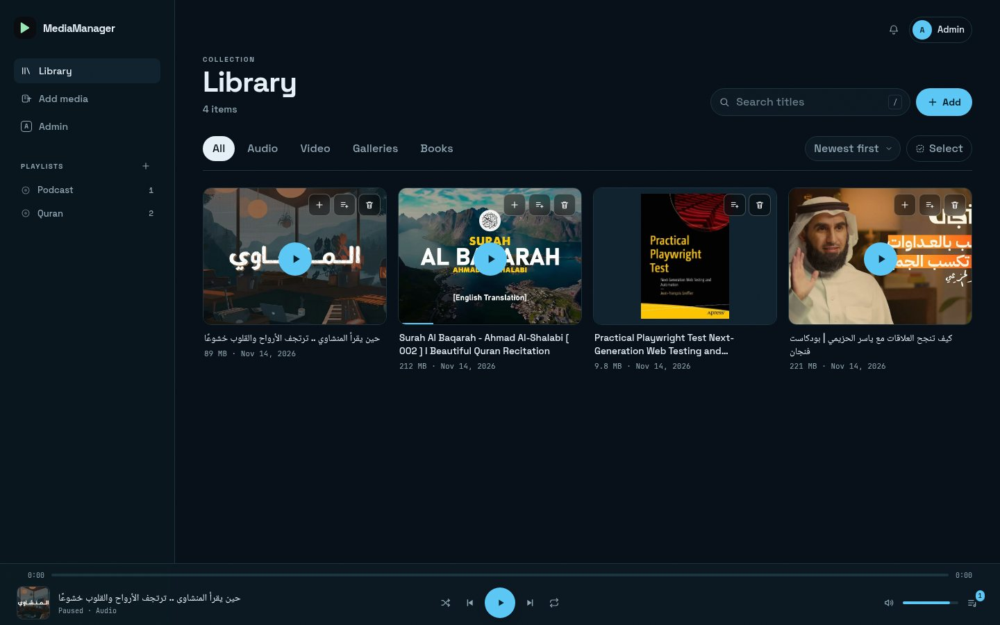
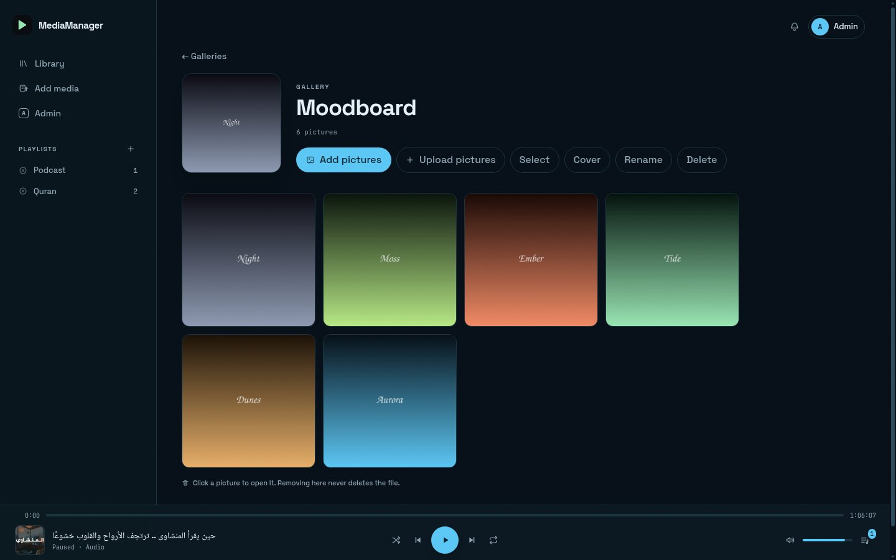
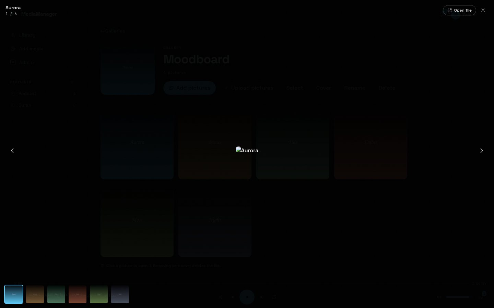
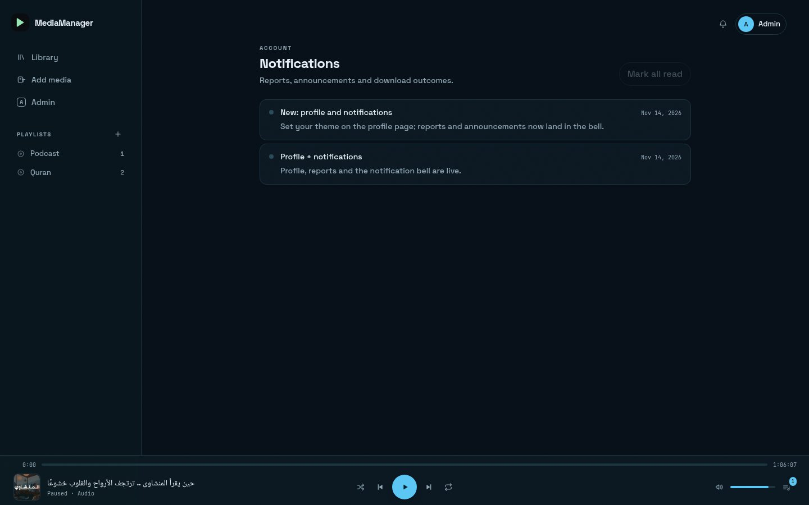
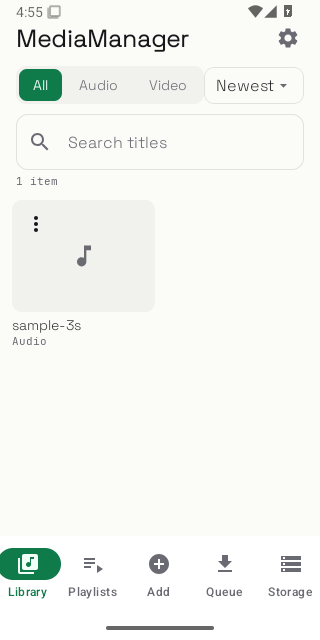

<p align="center">
  
</p>

<h1 align="center">MediaManager</h1>

<p align="center">
  A private library for downloaded audio, video, pictures, galleries and books.<br/>
  Rust API + SQLite on a machine you own, a web and desktop client, and a standalone Android app.
</p>

<p align="center">
  <a href="#quick-start">Quick start</a> ·
  <a href="#the-android-app">Android app</a> ·
  <a href="#architecture">Architecture</a> ·
  <a href="#documentation">Docs</a>
</p>



## What it does

**Downloads become a library.** Paste a link; yt-dlp/ffmpeg fetch audio with its
cover or the full video, and the files land in a plain, sharded folder tree that
survives the database. Uploads work for pictures, PDFs and EPUBs.

**Watching and listening.** One persistent player across navigation, a queue you
can reorder, resume points, shuffle, repeat, and speed. Videos seek with HTTP
Range because files are served by `ServeDir`, not buffered in memory.

**Organizing.** Ordered playlists hold any mix of kinds. Pictures live in galleries
with a protected `All pictures` default. Both use the same picker, and a playlist
cover can come from its own items or from your gallery.

**Knowing where the space went.** Idle audio/video with a source URL can be evicted
after 30 days, metadata kept, and the player re-downloads on demand. The desktop
and Android apps both report real usage per item with exact delete sizes.

**One library per person.** Email + password, private rows and files per user,
admin management, and `404` (never `403`) for someone else's data.

**Quiet by default.** Four theme families in light and dark, live updates over SSE,
a notification bell, and no accounts to create unless you want them.

## Screenshots

| Library | Galleries |
|---|---|
|  |  |
| **Gallery + lightbox** | **Full-screen viewer** |
|  |  |
| **Profile** | **Notifications** |
|  |  |

## The Android app

`apps/mobile` is a standalone Kotlin/Compose app: no account, no server, no sync.
Its own Room database, its own library in app-private storage, and the same
paste-a-link idea.

- **YouTube through NewPipe Extractor** (anonymous, no JS runtime, no PO token);
  every other site stays on the bundled yt-dlp. Audio is m4a/opus from YouTube,
  mp3 elsewhere.
- **Durable queue** in a `dataSync` foreground service; leaving the app or losing
  the process does not lose a job, and connectivity loss resumes by itself.
- **Player** with resume points, queue, playlists, repeat and shuffle.
- **Storage screen**: library total, phone used/free from `StatFs`, breakdown by
  kind, and every item ranked by size with the exact bytes a delete frees.

| Android library | Storage |
|---|---|
|  |  |

```sh
make mobile        # assembleDebug
make mobile-test   # unit + Robolectric tests
```

Device checklist, known limits and the build prerequisites live in
[`apps/mobile/README.md`](apps/mobile/README.md).

## Quick start

Requirements: Node 20+, Rust 1.85+, `yt-dlp`, `ffmpeg`. `pdftoppm` and `unzip` are
optional, used for book covers.

```sh
make install     # npm install + cargo fetch
make dev         # API :8787 and web :3000 (or :3001 if 3000 is taken)
```

Open the printed URL. A fresh database shows **Create the admin account**, or run
`make setup` in another terminal. Media created before accounts existed is adopted
by the first admin, so an upgrade never hides your library.

## Commands

| Command | What it does |
|---|---|
| `make dev` | API + web together |
| `make api` / `make worker` / `make web` | One process at a time |
| `make test` | Rust tests + Vitest |
| `make test-web` | Vitest only |
| `make check` | `cargo check` + `tsc --noEmit` |
| `make lint` | ESLint |
| `make e2e` | Real Chromium smoke test (needs `make dev`) |
| `make mobile` / `make mobile-test` | Android APK / unit tests |
| `make images` | Build API and web images with Podman |
| `make setup` | Create the first admin interactively |

## Architecture

```
apps/web        Next.js 15 client (App Router, TS strict, Tailwind v4)     :3000
apps/desktop    Tauri 2 window around the running web UI
apps/mobile     Standalone Kotlin app; own Room DB, no server
crates/api      Rust axum + tokio + sqlx/SQLite                             :8787
                roles: serve (API) | worker (jobs) | combined
library/        sharded media, .incoming/ per job, .thumbs/
```

The server owns SQLite and the files. Clients never write the database or compose
paths; they call `/api`, and files stream with Range. Jobs are rows with a lease,
not in-memory tasks, so a crash or a second worker changes nothing.

Full rules and gotchas: [`AGENTS.md`](AGENTS.md) and
[`docs/architecture.md`](docs/architecture.md).

## Deploying

- **[Docker Compose on a VM](docs/deploy-vm.md)** — multi-arch images
  (`ghcr.io/<repo>/api`, `/web`), optional Caddy TLS, `.env` for bootstrap and
  `MM_WEB_ORIGIN`.
- **Local install** — `scripts/install-local.sh` writes `mm`, `mm-desktop`, a
  `.desktop` launcher and `mm-api`/`mm-web` user services.
- Releases are built on `v*` tags: desktop bundles plus amd64/arm64 images.

## Documentation

| Document | Contents |
|---|---|
| [`AGENTS.md`](AGENTS.md) | Every rule, command and gotcha that has cost time |
| [`docs/architecture.md`](docs/architecture.md) | Layout, sync model, clients |
| [`docs/deploy-vm.md`](docs/deploy-vm.md) | VM walkthrough, Compose, TLS |
| [`apps/mobile/README.md`](apps/mobile/README.md) | Android build and device checklist |

## License

GPL-3.0. The Android app bundles yt-dlp, FFmpeg (via `youtubedl-android`) and
NewPipe Extractor; their licences are listed in Settings → About in the app.
