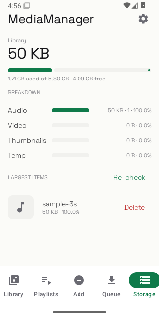
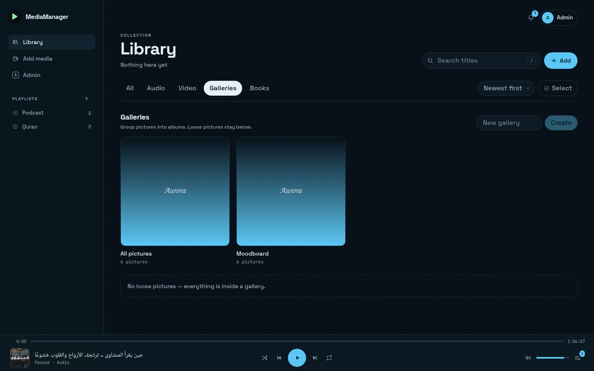
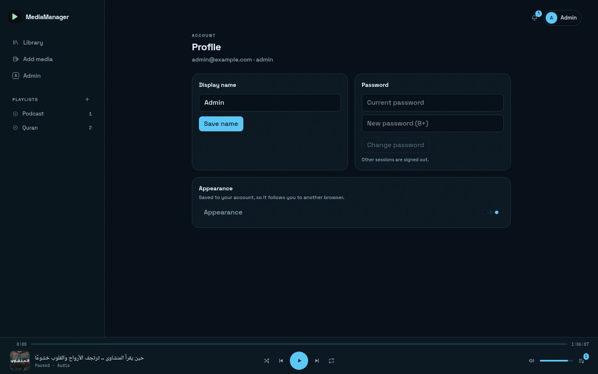
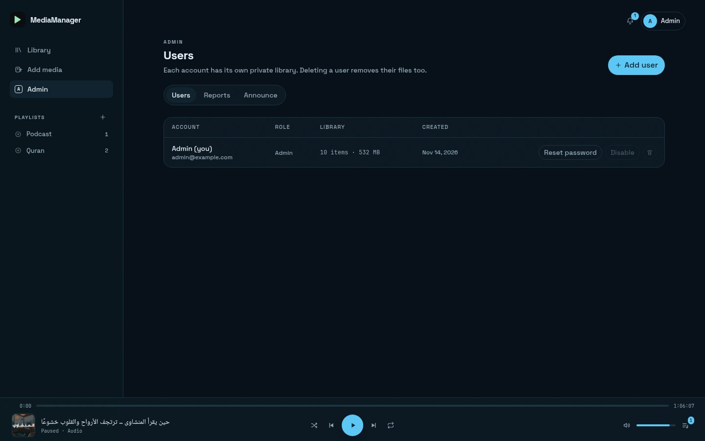

<p align="center">
  
</p>

<h1 align="center">MediaManager</h1>

<p align="center">
  A private library for downloaded audio, video, pictures, galleries and books.
  Rust API + SQLite on the server with a shared web/desktop UI, plus a standalone
  Android app that keeps everything on the phone.
</p>


## What it does

- **Downloads that become a library.** Paste a link; yt-dlp/ffmpeg fetch audio with
  its cover or the full video, and the app files it into a plain folder tree.
- **Persistent player and queue.** One media element survives navigation, with
  resume points, shuffle, repeat and a drag-to-reorder queue.
- **Galleries and playlists.** Pictures live in galleries (the classic
  `All pictures` default gallery is protected); playlists hold any mix of kinds.
- **Profile per account.** Display name, password, account-level theme, and bug
  or feature reports that land in an admin inbox.
- **Notifications.** Reports, report resolutions, admin announcements and
  finished/failed downloads arrive in a bell with an unread badge.
- **Idle media eviction.** Old untouched audio/video files are removed to save
  space while metadata stays; playing one downloads it again automatically.
- **Local accounts.** Email + password, private libraries per user, admin panel
  for user management. Another user's rows and files are `404`, not `403`.
- **Live updates.** SSE refreshes lists and badges without reloading.
- **Four themes** (Slate, Paper, Ocean, Moss) in light and dark, stored per account.

## Android app

`apps/mobile` is a standalone Kotlin/Compose app for the phone: no account, no
server, no sync. It has its own Room database and its own library in app-private
storage, and it is built around the same paste-a-link flow.

- **Paste a link → Audio or Video.** Audio is mp3 with cover art, video is mp4 at
  the height set in Settings. The extractor is bundled (`youtubedl-android`, yt-dlp
  + Python + ffmpeg), so the APK is ~76 MB for arm64.
- **Durable downloads.** The queue is a table; a foreground service works it, and
  leaving the app or losing the process does not lose a job.
- **Player, queue, playlists.** One ExoPlayer with a persistent bar, resume points
  saved in SQLite, play next / add to queue, ordered playlists.
- **Storage screen** — the reason it exists: library total, phone used/free from
  `StatFs`, a breakdown by kind (Audio, Video, Thumbnails, Temp), and every item
  ranked by size with its share and a delete that frees exactly that many bytes.
- **Same themes, same type.** Slate, Paper, Ocean and Moss × light/dark from the
  web tokens; Space Grotesk for text and JetBrains Mono for numbers.

```sh
make mobile        # assembleDebug
make mobile-test   # unit + Robolectric tests
```

Device checklist and known limits live in [`apps/mobile/README.md`](apps/mobile/README.md).

| Android library | Storage |
|---|---|
|  |  |

## Screenshots

| Galleries | Gallery + lightbox |
|---|---|
|  |  |
| **Profile** | **Admin** |
|  |  |

| Full-screen viewer | Notifications |
|---|---|
|  |  |

## Quick start

Requirements: Node 20+, Rust 1.85+, `yt-dlp`, `ffmpeg`; `pdftoppm` and `unzip`
for book covers.

```sh
make install     # npm install + cargo fetch
make dev         # API :8787 + web :3000 (or :3001 if 3000 is taken)
```

Open the printed URL. First run shows **Create the admin account** (or run
`make setup` in another terminal). Existing media from earlier versions is
adopted by the first admin.

### Install on this computer (Linux)

Build once and install the API + production web as systemd user services plus
the desktop binary and launcher entry:

```sh
cargo build --release --manifest-path crates/api/Cargo.toml
(cd apps/desktop && npm run build)
(cd apps/web && npm run build)
./scripts/install-local.sh
```

Then launch **MediaManager** from the app menu, or open <http://localhost:3001>.
Manage with `systemctl --user status mm-api mm-web`; stop them before `make dev`
(they share ports 8787/3001).

## Desktop (Tauri)

`apps/desktop` is a Tauri 2 window (Rust + WebKitGTK) that loads the same UI.
It is not a second frontend.

```sh
make dev                 # keep the server running
cd apps/desktop
npm install
npm run dev              # native window
npm run build            # AppImage / deb / rpm in src-tauri/target/release/bundle
```

`MM_DESKTOP_URL` overrides the target (default `http://localhost:3001`). The
window resizes down to 360×560 and the layout adapts like the web app.

## Accounts and privacy

- The first admin is created at `/setup`, by `MM_ADMIN_EMAIL`/`MM_ADMIN_PASSWORD`,
  or interactively with `make setup`.
- Admins create users, change roles, disable accounts, reset passwords (which
  revokes that user's sessions) and delete users with their content.
- Every query is owner-scoped; `/files` and `/thumbs` authorize by row lookup and
  still support HTTP Range for video seeking.
- Cookies are `HttpOnly`, `SameSite=Lax`, 30 days by default. Set
  `MM_COOKIE_SECURE=1` behind HTTPS.
- Reports are filed by non-admins on `/profile`; admins resolve them in
  **Admin → Reports** and the reporter gets a notification.
- Admins broadcast one announcement per enabled user from **Admin → Announce**.

## Idle media eviction

`MM_EVICT_AFTER_DAYS` (default 30, `0` disables) removes only the media files of
audio/video that have not been played for that long, keeping the item, thumbnail,
playlists and resume position. Uploads are never evicted (no source URL).
Playing an evicted item queues a restore, shows “Restoring media…”, and resumes
when the download finishes.

## Configuration

All settings are environment variables; see `.env.example`.

| Variable | Default | Purpose |
|---|---|---|
| `MM_LIBRARY_DIR` | `~/MediaManager/library` | media, thumbnails and SQLite |
| `MM_BIND` | `127.0.0.1:8787` | API bind address |
| `MM_WEB_ORIGIN` | `http://localhost:3000` | CORS/CSRF origin |
| `MM_MAX_DOWNLOAD_MB` | `2048` | upload/download cap |
| `MM_MAX_CONCURRENT` | `8` | worker concurrency |
| `MM_EVICT_AFTER_DAYS` | `30` | idle eviction (0 = off) |
| `MM_EVICT_CHECK_HOURS` | `24` | scheduler interval |
| `MM_ADMIN_EMAIL` / `MM_ADMIN_PASSWORD` | — | first admin bootstrap |
| `MM_SESSION_DAYS` | `30` | session lifetime |
| `MM_COOKIE_SECURE` | `0` | set `1` behind TLS |
| `MM_OPENER` | `xdg-open` | native book opener |

## Architecture

- **Rust API** (`crates/api`): axum, SQLite in WAL, durable job queue, worker,
  yt-dlp/ffmpeg, owner-scoped files.
- **Next.js web** (`apps/web`): App Router, client pages, Tailwind v4, custom
  design-system controls. Proxies `/api`, `/files`, `/thumbs` to the API.
- **Tauri desktop** (`apps/desktop`): native window around the same UI.
- **Sync foundation**: append-only `sync_changes`, owner-scoped pull endpoint,
  per-owner change log; media streams on demand. See `docs/architecture.md`.
- Storage is sharded (`<kind>/<prefix>/<id>.<ext>`), thumbnails in `.thumbs/`.
  The DB is never written by the web client.

## CI/CD and deployment

- **CI** (`.github/workflows/ci.yml`): Rust fmt + tests, web typecheck/lint/tests/
  build, a real Chromium smoke test, and Docker image builds.
- **Release** (`.github/workflows/release.yml`): on `v*` tags, desktop bundles
  (AppImage/deb/rpm) and multi-arch (`amd64`/`arm64`) images on GHCR.
- **Deploy** (`.github/workflows/deploy.yml`): on a published release or manual
  dispatch, SSH → checkout tag → `compose pull && up -d`.
- `compose.yaml` runs `api` + `web` with an optional Caddy TLS profile; both
  Docker and Podman are supported (`compose.podman.yaml`).

Step-by-step VM setup (Oracle Free Tier, generic VPS, TLS, backups):
[`docs/deploy-vm.md`](docs/deploy-vm.md). Design decisions:
[`docs/superpowers/specs/2026-11-15-vm-deployment.md`](docs/superpowers/specs/2026-11-15-vm-deployment.md).

## Development

```sh
make test        # cargo test + vitest
make test-web    # vitest only
make check       # cargo check + tsc --noEmit
make lint        # eslint
make e2e         # Chromium smoke; needs the app running + MM_E2E_EMAIL/PASSWORD
```

Single tests:

```sh
cargo test --manifest-path crates/api/Cargo.toml <name>
cd apps/web && npx vitest run src/lib/player-utils.test.ts
```

Do not run `next build` while `next dev` is running — they share `.next`.
`next build` must work with the API down.

## Project layout

```
crates/api/        Rust API, worker, migrations, SQLite
apps/web/          Next.js UI
apps/desktop/      Tauri 2 shell + icons
scripts/           first-run and local installer
deploy/            server env example + Caddyfile
compose.yaml       container stack
docs/              architecture, deployment, specs, plans, screenshots
```

## Security

- No telemetry. The server is loopback-only by default; expose it through a
  reverse proxy or Tailscale, not directly.
- Never commit `.env`, the library, the SQLite files, or logs — `.gitignore`
  covers them. Set `MM_COOKIE_SECURE=1` when served over HTTPS.
- For media at rest, use full-disk encryption (LUKS); the app does not encrypt
  individual files.

## More docs

- [`docs/architecture.md`](docs/architecture.md) — structure and sync model
- [`docs/deploy-vm.md`](docs/deploy-vm.md) — VM deployment walkthrough
- [`AGENTS.md`](AGENTS.md) — rules for working in this repo
- [`docs/superpowers/specs/`](docs/superpowers/specs) — specs and designs
